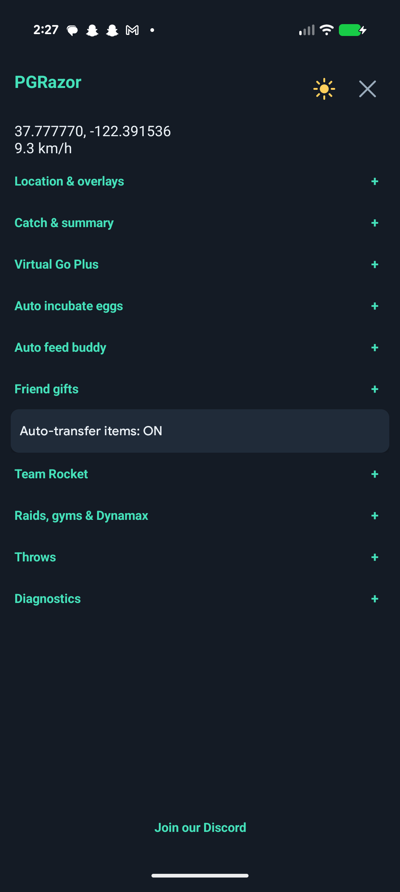

<p align="center"></p>
<h1 align="center">PGRazor</h1>
<p align="center">A compact Android interface for location controls and Pokémon GO automation.</p>

PGRazor adds an in-game menu, independent joystick, encounter controls, and optional automation. Settings persist across restarts, with light and dark themes.

**Working APK releases are private.** Original game APKs, signing keys, private build artifacts, and investigation logs are excluded from Git. Selected map artwork is bundled with provenance; see [third-party notices](THIRD_PARTY.md). The release workflow refuses to build or publish a playable APK in a public repository.

## Install a private release

1. Open [Releases](https://github.com/jpitty03/PGRazor/releases) with an account that has access.
2. Download **PGRazor.apk**, not a source archive or preview.
3. Transfer it to your ARM64 Android phone, allow installation from your chosen file manager, and open the APK.
4. Launch PGRazor and tap the small **R** icon to open the quick menu. Choose **Settings** for the full-screen controls.

Private releases are test candidates; check their release notes for device-validation status. The current game baseline is **Pokémon GO 0.433.1 / 2026101502**. Native hooks are version-specific. A different game version can leave features unavailable.

The Android package identity stays compatible with the game. An official-store installation uses a different signing certificate and cannot be updated in place with a PGRazor build. This pre-release uses a fresh PGRazor signing key and settings namespace; install it fresh. See [installation and builds](docs/BUILDING.md).

## Main menu

<p align="center"></p>

## Features

| Area | Controls |
| --- | --- |
| Map | Camera-relative joystick, saved locations, routes, Autowalk, tap-to-walk/teleport, nearby stop/gym/raid layers |
| Catching | Quick Catch, throw grade/curveball options, IV display, berry selector |
| Inventory | Transfer newly caught Pokémon below 90% IV; configurable item limits |
| Keep rules | Legendary/mythical/Ultra Beasts, shiny, event/costume, background, **XXS**, **XXL**; favorites and eggs always kept |
| Virtual Go Plus | Nearby wild catches with red balls, nearby stop spins, optional notifications, target marker and activity status |
| Eggs | Unlimited incubator only; shortest- or longest-distance priority |
| LivePokeMap | Remote Pokémon, stops, gyms, raids, and stations; requires a LivePokeMap subscription |
| Other automation | Rocket/raid/gym/Dynamax controls, buddy feeding, gift opening/sending, quick spin |
| Interface | Quick menu, full-screen settings, separate joystick, cooldown history, light/dark themes |

**Quick menu:** Map, speed presets (0, 9.3, 16, 30 km/h), Autowalk, Feeds, Favorites, Teleport, and Settings. Favorites shares the map's saved places. Autowalk builds a route through up to 50 nearby loaded stops and gyms, with optional looping. Routes use direct segments between locations. Zero speed pauses travel; selecting another speed resumes the current route. Backgrounding stops routes rather than resuming movement automatically.

**Auto incubation:** Uses only the unlimited incubator, with shortest- or longest-distance egg priority. Checks while on the game map and starts another egg after the incubator becomes free. Limited-use, Super, and timed incubators are not used.

**Overlay positions:** Drag the cooldown timer or VGP icon to reposition it. Positions are saved; the VGP status label follows its icon. A tap still opens cooldown history or toggles VGP.

**VGP:** the settings switch shows or hides its overlay. Tap the connected/disconnected device icon to start or stop VGP; ON/OFF labels show its state. VGP starts off and switches off when the app leaves the foreground. Optional **Stop on cooldown (estimated)** also switches it off until you manually restart it. Catch and item automation follow their existing settings and protection rules.

**LivePokeMap feeds:** Requires an active subscription to [LivePokeMap](https://play.livepokemap.com/), purchased separately from their service. Open **Feeds** and sign in with your own account on the phone. The feed lists remote Pokémon, stops, gyms, raids, and stations around your current location. Filter by category, radius, and minimum Pokémon IV; select a result for Map, Walk, or Teleport. The session token is stored encrypted with Android Keystore; the password is never saved. Logout removes the token. Refresh stops when the feed closes or the app leaves the foreground. Remote sightings can expire and are separate from locations loaded by the game. This uses LivePokeMap's observed web interface, which may change; access depends on your account and service availability.

The map and cooldown history open full screen using the selected PGRazor theme. Select a map pin, then choose Walk here or Teleport. The manual route planner also offers Loop route (off by default). Map tiles retain their original colors.

The world map layers show locations currently loaded by the game near your avatar, not remote search results. Markers use bundled game artwork, with gym team-color rings and distinct raid categories. Tap a marker for live gym/raid details; overlapping markers open a chooser. Egg badges identify unhatched raids. Small x/6 labels show gym defenders directly on the map; raid details resolve base-species names from bundled English game text. Unknown species keep their numeric fallback. Layer choices persist. Tile loading uses the [OpenStreetMap tile policy](https://operations.osmfoundation.org/policies/tiles/), including local caching and visible tiles only.

These are experimental client modifications. Server outcomes are not guaranteed. The AR+ option and local spawn-range changes do not prove server-side bonuses. Cooldown is a local estimate. Do not interpret a successful build as device validation.

Join the [PGRazor Discord community](https://discord.gg/9QqfkDSQX3). You can also open it from the settings footer.

## Build and contribute

- [Build, signing, private CI, and installation](docs/BUILDING.md)
- [Architecture and compatibility](docs/ARCHITECTURE.md)
- [Contributing and checks](CONTRIBUTING.md)
- [Third-party notices](THIRD_PARTY.md)

```powershell
python -B tools/check.py
```

Source CI runs device-free checks and compiles the Android controls. Its downloadable artifact contains **source and tools only**, not a playable APK. Private playable releases are produced separately by the manually triggered **Private playable APK** workflow.

## Repository layout

```text
.github/workflows/       Source CI and private release workflow
docs/                    Build and architecture guides
pgrazor/src/      Android UI and control bridge
pgrazor/diagnostics/  Version-specific native hooks
pgrazor/test/     Regression tests
pgrazor/vendor/   Pinned bridge, provenance, and licenses
tools/                   Checks, source packaging, private CI setup
```

PGRazor uses the `pgrazor/` project directory and `dev.pgrazor` Java namespace. Assets, settings, logs, build outputs, and tooling use the same name. There are no legacy-name aliases or settings migrations.

## License

Original PGRazor source is available under the [MIT License](LICENSE). Third-party components retain their own licenses. Pokémon GO and its assets are not covered by this license. PGRazor is an independent project and is not affiliated with the game publisher.
